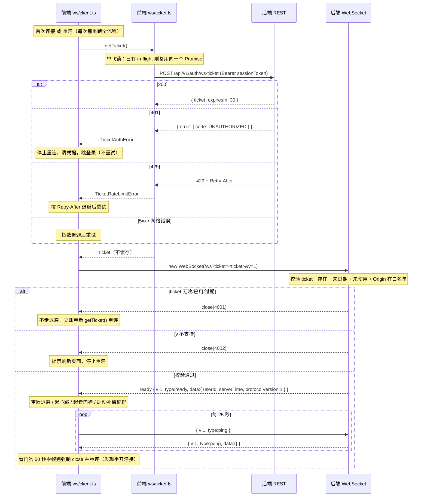
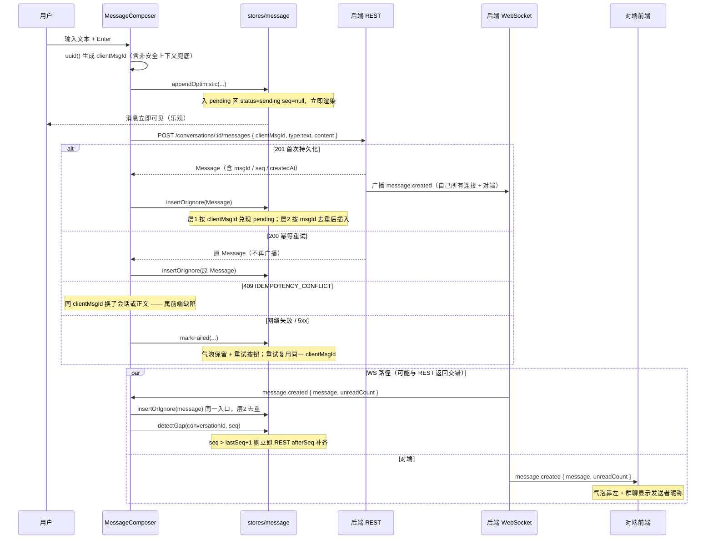
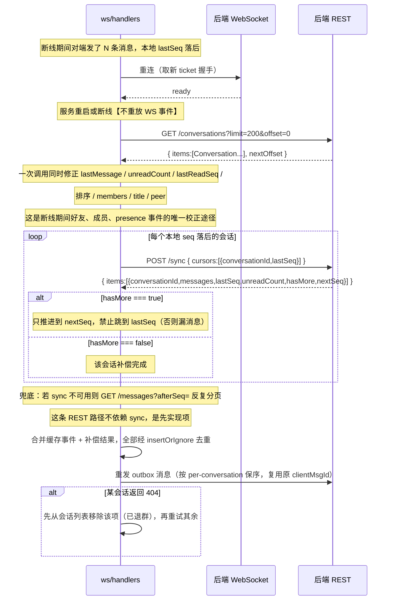
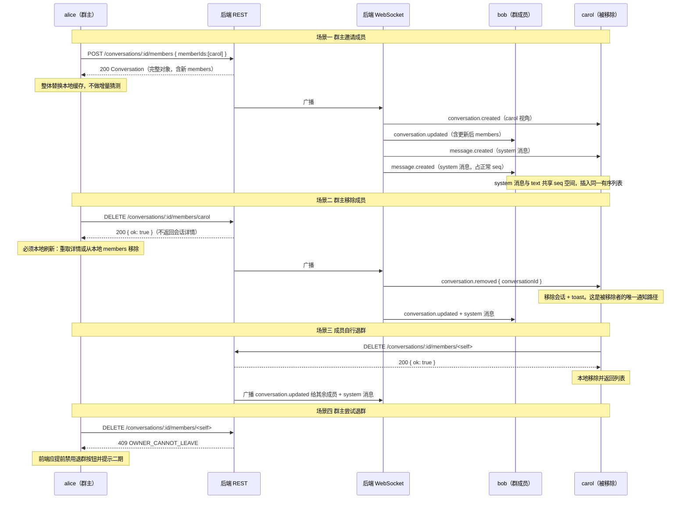

# 03 · WebSocket 协议

> 事实源：`backend/API.md` 第 6 节 + `backend/openapi.json` 0.2.0。
> 机读版：`contracts/requirements/ws-requirements.json`（v0.2.0）。
> 本文由 `scripts/check-contract.mjs` 校验：required 帧与关闭码必须出现在本文件，否则门禁报 ERROR。

---

## 1. 连接与鉴权

### 1.1 为什么用 ticket 而不是 Bearer

浏览器 WebSocket API **不允许**设置自定义请求头，因此无法直接带 `Authorization: Bearer`。把长期 `sessionToken` 放进 URL query 会让它进入服务端 access log、反向代理日志与浏览器历史，后端对此明确禁止（API.md：「不得把长期 token 放到 URL 中」）。

因此采用**一次性短效票据**：

```
POST /api/v1/auth/ws-ticket        （带 Authorization: Bearer <sessionToken>）
  → 200 { "ticket": "<opaque>", "expiresIn": 30 }

new WebSocket("ws://127.0.0.1:3001/ws?ticket=<ticket>&v=1")
```

### 1.2 ticket 与 sessionToken 的关系

| | sessionToken | ticket |
|---|---|---|
| 是什么 | **身份** | **一次握手凭证** |
| 寿命 | 默认 7 天，可用 `POST /auth/session/refresh` 滑动续期 | 30 秒 |
| 可复用 | 是（可换任意数量 ticket） | **否，一次性，握手成功即作废** |
| 存放位置 | localStorage（`aitrance.session`） | 只在 URL query 里，**绝不落盘、绝不缓存** |
| 谁校验 | 每个 REST 请求 + WS 建连时 | 仅 WS 握手一次 |

泄露影响：ticket 泄露的窗口只有 30 秒且只能用一次；sessionToken 从不进入 URL。

### 1.3 ticket 三条语义（最容易实现错的地方）

1. **一次性** —— 握手成功即作废，重放必须拒绝（后端返回 4001）。
2. **TTL 30 秒**。
3. **不决定连接寿命** —— 握手成功后票据过期**不得**断开连接；会话有效性由 sessionToken 的周期性校验负责（最多每 30 秒一次心跳中检查）。若把 ticket 当会话凭证持续校验，用户会每 30 秒被踢一次。

### 1.4 前端强制纪律（`frontend/src/ws/ticket.ts`）

- **禁止缓存**：每个 WebSocket 对象配一个新 ticket。两个标签页 = 两个 ticket；同一标签页重连 3 次 = 3 个 ticket。
- **单飞**：同一时刻只允许一个 in-flight 请求。否则并发重连会打出 N 个请求，而 ticket 是单次的，多出来的全废。
- **失败分类**：
  - `401` → 身份已失效，**停止重连**，清凭据，跳登录（重试无意义）
  - `429` → 按 `Retry-After` 等待，退避继续
  - 网络错误 / 5xx → 正常指数退避重试
- **票据获取失败不影响已建立的连接**（只在建连路径上取票）。

### 1.5 Origin 校验

WebSocket **不受 CORS 约束**，因此这是 WS 的 CSRF 面。服务端必须校验 `Origin` 头，非白名单来源直接拒绝握手。

---

## 2. 信封格式

### 2.1 服务端 → 客户端

```ts
interface ServerEnvelope<T extends string = string, D = unknown> {
  v: 1                    // 协议版本。不匹配则客户端提示刷新并停止重连
  id: string              // 事件 UUID，服务端生成
  type: T                 // 事件类型，见 §4
  timestamp: string       // ISO 8601 UTC 毫秒
  data: D                 // 类型相关载荷
}
```

示例：

```json
{
  "v": 1,
  "id": "3f9c1e2a-...",
  "type": "message.created",
  "timestamp": "2026-09-28T01:23:45.678Z",
  "data": { "message": { "...": "完整 Message" }, "unreadCount": 2 }
}
```

### 2.2 客户端 → 服务端

```ts
interface ClientEnvelope {
  v: 1
  type: "ping" | "typing"
  // typing 额外携带：
  conversationId?: string
  active?: boolean
}
```

客户端帧**不带** `id` / `timestamp`，也无需服务端回执。

### 2.3 与 v0.1 需求书的差异（重要）

| 项 | v0.1 我方提案 | 后端实际 | 影响 |
|---|---|---|---|
| 信封字段名 | `{v,type,reqId?,seq?,ts,payload}` | `{v,id,type,timestamp,data}` | 已按后端改写全部前端帧构造与解析 |
| **连接级 seq** | `Envelope.seq` 单调递增，用于连接内丢帧检测 | **不存在** | 前端**已废弃** `lastConnSeq`。缺口检测只能依赖 `Message.seq`（会话级）的连续性 |
| 消息正文 | `body: { text }` | `content: string` | 归一化层已适配 |
| 发消息 | WS `message.send` + `message.ack` | **走 REST** | 前端 `MessageComposer` 直接调 REST，无 WS ack 路径 |
| 已读 | WS `message.read` + `message.read.updated` | WS 侧为 REST + `conversation.read` 事件 | REST 上报 204，回执由服务端事件推送 |
| 补偿 | WS `conversation.sync` + `sync.result` | **不存在**，只有 REST `POST /api/v1/sync` | 前端补偿以 REST 为主路径 |

> **发消息走 REST 是后端的选择，我方认可**：原生幂等、状态码明确、重试简单、可脱离 WS 单独验证。代价是「自己发的消息」会从两条路径到达（REST 返回 + `message.created` 事件推给自己所有连接），因此去重入口必须唯一。

**我方唯一保留的阻塞项 `v:1`** 已被后端接受并实现（不匹配以 4002 关闭）。这是唯一一处我方坚持的协议字段 —— 没有它，任何不兼容变更都无法协商，前端只能盲目重连。

---
## 3. 时序图

### 3.1 ticket 握手与建连



### 3.2 乐观发送（REST 主路径 + WS 广播）



### 3.3 断线重连补偿



### 3.4 群成员变更



> **与 v0.1 提案的差异**：后端**没有** `conversation.member.changed` 帧。因此：
> - 他人视角的成员变更 → 靠 `conversation.updated` 携带完整 `members` 数组，前端整体替换（不做增量）。
> - 自己被移除 → 只能靠 `conversation.removed`，不能指望 member.changed 里带 `change:removed`。

---

## 4. 事件类型总表

### 4.1 客户端 → 服务端（2 个）

| type | 载荷 | 说明 |
|---|---|---|
| `ping` | 无（仅 `{v:1,type:"ping"}`） | 应用层心跳，前端每 25 秒一次；后端回 `pong` |
| `typing` | `{ conversationId, active: boolean }` | 前端节流：首次立即发 `true`，此后每 3 秒最多一次；停手 5 秒 / 发消息 / 切会话 / 失焦发 `false` |

### 4.2 服务端 → 客户端（13 个）

| type | data | 前端反应 |
|---|---|---|
| `ready` | `{ userId, serverTime, protocolVersion:1 }` | 取 `serverTime` 做时钟偏移（缺失退回信封 `timestamp`）；`protocolVersion !== 1` 则停重连；重置退避、起心跳与看门狗、启动补偿编排 |
| `pong` | `{}` | 刷新看门狗（无 clientTs 回显，故无法测 RTT） |
| `message.created` | `{ message: Message, unreadCount }` | 缺口检测 → `insertOrIgnore` → 更新列表预览与未读。含自己所有连接。`message.type` 可能是 `image`/`file`，此时 `message.attachment` 非 null，见 §4.5 |
| `conversation.created` | `{ conversation: Conversation }` | upsert 到会话列表（别人给我建私聊 / 我被拉进群） |
| `conversation.updated` | `{ conversation: Conversation }` | upsert 且**默认保持列表位置**，仅 `updatedAt` 变新时才重排 |
| `conversation.removed` | `{ conversationId }` | 移除该会话 + toast。被移除者的唯一通知路径 |
| `conversation.read` | `{ conversationId, userId, lastReadSeq, unreadCount }` | 见 §4.3 |
| `conversation.pins` | `{ conversationId, pins: PinnedMessage[] }` | **完整列表**，不是增量：收到即整体替换该会话的置顶条（见 §4.6） |
| `friend.requested` | `{ request: FriendRequest }` | 加入待处理申请 + toast。申请双方都收到 |
| `friend.resolved` | `{ request: FriendRequest }` | 按 `status` 区分接受/拒绝。申请双方都收到 |
| `presence.changed` | `{ userId, online }` | 更新在线圆点。推给好友与同群成员 |
| `typing.changed` | `{ conversationId, userId, active }` | `active=true` 记 `expiresAt = now + 6s`；`false` 立即清除 |
| `error` | `{ code, message }` | 记录 warn + 检查出站帧构造；不重连、不断开 |

### 4.3 `conversation.read` 的两条前端规则

```ts
case "conversation.read": {
  const { conversationId, userId, lastReadSeq, unreadCount } = data

  // 规则 1（无条件）：采用服务端权威 unreadCount 覆盖本地。
  //   理由：「读到历史位置**不一定**把未读清零」（契约 §5），
  //   前端无法自行推断真实剩余未读，必须以服务端值为准。
  //   注意 userId 可能是**自己**（多端场景，另一台设备触发的读）——
  //   此时同样要应用，否则多端红点不一致。
  if (userId === auth.userId) {
    // 实际实现见 src/ws/handlers.ts：直接 upsertSummary 写入
    // lastReadSeq 与 unreadCount（keepPosition，不改变列表顺序）。
    // conversation store 没有单独的 applySelfRead 方法，此处不虚构 API。
    const conv = conversationStore.summariesById.get(conversationId)
    if (conv) {
      conversationStore.upsertSummary(
        {
          ...conv,
          lastReadSeq: Math.max(conv.lastReadSeq, lastReadSeq),
          unreadCount: unreadCount ?? conv.unreadCount,
        },
        { keepPosition: true },
      )
    }
    break
  }

  // 规则 2：他人已读 → 更新成员已读游标（单聊「已读」标记 / 群聊「N 人已读」）
  messageStore.applyMemberReadSeq(conversationId, userId, lastReadSeq)
  conversationStore.applyReadReceipt(conversationId, userId, lastReadSeq)
  break
}
```

> **修正记录（同 minor，未 bump 版本）**：本节曾规定「`userId === 自己` 时直接忽略，否则红点闪烁」。该规则与多端权威未读语义相反 —— 自己另一台设备的已读若不应用，本端红点就会与服务端不一致。现已改为「两条分支都必须落」。`src/ws/handlers.ts` 的实现与此一致。

另有两条**必须**的语义：

- `unreadCount` 是**接收者自己的**未读数，不是 `userId`（读者）的未读数 —— 不要搞混。
- 收到本事件时**必须**用其 `unreadCount` 覆盖本地未读数。因为 `POST /conversations/:id/read` 返回 204 无正文，且**读到历史位置并不一定把未读清零**（未读数按实际剩余消息计算）。前端本地清零只是乐观显示。

### 4.4 已读上报流程

已读走 **REST**，不走 WS：

```
前端打开会话 / 收到新消息且该会话为活跃会话
  → conversationStore.clearUnreadLocally(id)     本地乐观清零
  → POST /api/v1/conversations/:id/read { lastReadSeq }   → 204 无正文
  → 服务端向所有成员 + 我自己所有连接推 conversation.read
  → 前端收到后**两条分支都应用**（见 §4.3）：
      · userId 是自己（多端，另一台设备读的）→ 应用 lastReadSeq + unreadCount
      · userId 是他人                        → 更新成员已读游标
  → 用事件里的权威 unreadCount 覆盖本地值（含「读到历史位置不一定清零」的情况）
```

> **注意**：`lastReadSeq` 必须是**当前会话已有消息**的 seq，不能提交未来游标（否则 400 `INVALID_READ_CURSOR`）。0 合法。

### 4.5 附件消息（`type: image` / `type: file`）

附件**没有独立的 WS 事件**：没有 `upload.created`、也没有 `attachment.*` 帧。上传是 REST 同步返回，附件消息也走 REST 发消息。WS 侧唯一的改动是 `message.created` 的 `data.message` 现在可能带附件。

```
选文件 → POST /api/v1/uploads?filename=<encodeURIComponent(名)>   （裸 body，Bearer 必需）
       → 201 { id, name, mimeType, size, sha256, kind, url, createdAt }
       → POST /api/v1/conversations/:id/messages { clientMsgId, attachmentId }
       → 201/200 同普通消息；服务端按上传物 kind 推导 message.type
       → 广播 message.created { message(含 attachment), unreadCount }
```

字段语义（与 REST 契约 `definitions.Attachment` 完全一致）：

| 字段 | 说明 |
|---|---|
| `attachment` | **恒存在的可空字段**。纯文本与 system 消息为 `null`，不是省略、不是 `undefined` |
| `attachment.kind` | `image` 当且仅当服务端嗅探的 mimeType 以 `image/` 开头，否则 `file`；它决定消息 `type` 与下载时的 `Content-Disposition` |
| `attachment.url` | 相对路径 `/api/v1/uploads/<id>`，**必须带 Bearer 才能取字节**（他人访问 403，不存在 404） |
| `sha256` | 只在**上传 201 响应**里出现一次，`attachment` 内没有；消息里不做完整性校验 |
| `ownerId` | `attachment` 内不暴露（隐私且前端无用途） |

前端渲染纪律：

- **禁止**把 `attachment.url` 直接填进 `` —— 浏览器不会带 `Authorization`，必然 401。
  正确路径：带 Bearer 的 `fetch(url)` → `res.blob()` → `URL.createObjectURL(blob)` → `img.src`，组件卸载时 `revokeObjectURL`。CSP 的 `img-src` 已放行 `blob:`。
- 收到的 `message.created` 可能早于本地拿到 blob URL，因此气泡必须先占位再异步取字节，失败降级为灰色占位（保留消息本体，不要删消息）。
- 上传成功但发消息失败时附件成为孤儿：可重试发消息，或 `DELETE /api/v1/uploads/{id}` 主动回收（已附着返回 409 `UPLOAD_IN_USE`，属正常语义，静默忽略）。
- 一个上传物只能附着一条消息（复用返回 409 `UPLOAD_IN_USE`）；消息本身不可编辑，故附件也不需要可变引用。

> 已知限制：`GET /api/v1/uploads/:id` 要求「属主本人 **或** 该附件被某条消息引用且请求者是该会话成员」，其余 403 `FORBIDDEN`。因此**对方发来的附件现在可以正常渲染了**（第二轮 UX 修复的 P0 项）。但「刚上传、还没发出去的草稿附件」除属主外谁都读不到 —— 这是有意的：否则任何拿到 uuid 的人都能读别人正在编辑的附件。

### 4.6 消息置顶（`conversation.pins`）

置顶同样只走 REST，WS 只负责「广播变化后的完整列表」：

```
POST   /api/v1/conversations/:id/pins            { msgId }   → 201 新建 / 200 幂等（已置顶）
DELETE /api/v1/conversations/:id/pins/:msgId                 → 204 无正文
GET    /api/v1/conversations/:id/pins                        → 200 { items: PinnedMessage[] }
   ↓ 服务端向该会话全体成员 publish
{ v:1, id, type: "conversation.pins", timestamp, data: { conversationId, pins: PinnedMessage[] } }
```

`PinnedMessage` 形状（与 REST 契约 `definitions.PinnedMessage` 一致）：

| 字段 | 说明 |
|---|---|
| `id` | pin 记录自身的 id（**不是** msgId），前端列表 key 用它 |
| `message` | 完整 `Message`，含 `attachment`，可直接复用气泡渲染 |
| `pinnedBy` | 完整 `User`（含 uid / role / status），用于「谁置顶的」 |
| `pinnedAt` | ISO 8601 UTC |

前端纪律：

- `data.pins` 是**完整列表**而不是增量，收到即整体替换该会话的置顶条，不要做 merge。
- 顺序即服务端顺序（`pinned_at DESC`），前端不要重排。
- **幂等重放不广播**：同一条消息重复置顶返回 200 但服务端不 publish（连点两下不会出现两条事件）。前端也不要因为本地按钮连点就插入两条。
- 取消置顶恒广播，包括把最后一条取消掉时推 `pins: []`（前端据此隐藏置顶条，而不是等下一次拉取）。
- 消息被保留策略删掉后，悬空的 pin 记录在读列表时被静默跳过，因此召回列表可能短于实际 pin 行数；这是有意的（不让一个悬空引用把整个列表请求打成 500）。

> 置顶权限：`owner` / `admin` / `member` 都可以置顶与取消（契约 §7.1）；单会话上限 50 条，超出返回 409 `PIN_LIMIT`。

---

## 5. 心跳、看门狗与重连

| 项 | 值 |
|---|---|
| 传输层 ping | 服务端每 30 秒协议层 ping，浏览器自动回 pong；连续下一轮无 pong 则服务端终止 |
| 应用层 ping | 前端每 **25 秒**发 `{v:1,type:"ping"}` |
| 客户端看门狗 | **任意帧都算活性**；**50 秒**（2× 心跳）内零帧 → 强制 `close()` 进入重连 |
| 退避序列 | `1s → 2s → 4s → 8s → 16s → 30s`（上限），±20% 抖动；收到 `ready` 重置 |
| 重连上限 | 无限（长连接聊天不能放弃），退避封顶 30 秒；连续 10 次失败 → 提示「网络异常」 |
| typing 展示超时 | 收到 `active:true` 记 `expiresAt = now + 6s`，每秒定时清理 |

看门狗的存在理由：半开连接（TCP 层不报错但报文不再到达）无法靠 `onclose` 发现，必须靠「一段时间内零帧」判定。

---

## 6. 关闭码

### 6.1 服务端发出

| 码 | 含义 | 前端策略 |
|---|---|---|
| `4001` | ticket 缺失/格式错误/失效/已用 | **重新申请 ticket 后重连（不走退避）**；若同期 REST 返回 401 则改为登出 |
| `4002` | 不支持的 v | 提示刷新/更新前端；**不盲目重连** |
| `4003` | session 过期或已注销 | **停止自动重连**，清登录状态并跳登录；**禁止对失效 token 调 refresh** |
| `1003` | 收到二进制帧（不受支持） | 客户端缺陷：停止重连并打日志；前端只发 JSON 文本帧 |
| `1008` | 超连接数（每**用户**跨 session 累计 5 条）或超帧频（30 帧/10 秒） | 退避重连；**不得据此登出**（session 失效已由 `4003` 承载） |
| `1009` | 单帧超过 4 KiB | 前端缺陷：检查出站帧体积（严禁把大 payload 塞进 WS） |
| `1013` | 慢消费者，服务端积压超 1 MiB 主动断开 | 退避重连并走一次 sync 补偿 |
| `1006` | 非正常断连或心跳超时 | 指数退避 + 获取新票据后重连 |

> **修正记录（同 minor，未 bump 版本）**：本表曾把 session 失效、超连接数、超帧频、二进制帧全部并到 `1008`，并把策略写成「先 `GET /auth/session`：401 则登出」。后端 v0.2.0 已拆分语义：**`4003` = session 层失效（登出信号），`1008` = 连接层限流（退避信号），`1003` = 二进制帧**。混用会让前端无法判断该登出还是该重连。`src/ws/constants.ts` 与 `src/ws/client.ts` 已按本表逐码分支实现。

### 6.2 客户端合成（本地状态机使用，不代表服务端会发）

| 码 | 含义 | 策略 |
|---|---|---|
| `1000` | 客户端主动正常关闭（登出） | 不重连 |
| `1001` | 客户端看门狗超时后主动关闭 | 关闭后照常退避重连 |
| `4000` | 协议版本不匹配时客户端主动关闭（等价 4002 语义） | 不重连 |

> **与 v0.1 的差异**：v0.1 自拟的 `4004`（未提供 ticket）、`4029`（限流）、`1011`（服务端错误）后端**并未采用**，已从契约中删除。**`4003` 已被后端采纳**（session 过期/注销），见 §6.1 —— 本节此前误写为「4003 也未采用」，与已冻结的 `closeCodes` 矛盾，已更正。`4001` 与 `4002` 是我方向后端争取保留的（后端已 ACK 并实现），因为二者语义与 `1008` 不同 —— 合并进 `1008` 会让前端无法区分「可自愈的票据问题」与「必须重新登录」。

---

## 7. 顺序、去重与多端

### 7.1 排序

始终按 `Message.seq` 升序。**绝不用 `createdAt` 排序** —— 客户端与服务端时钟偏移会导致消息跳跃。

### 7.2 三层去重（全部收敛到一个 `insertOrIgnore` 入口）

| 层 | 键 | 作用 |
|---|---|---|
| 1 | `pendingByClientMsgId: Map<clientMsgId, LocalMessage>` | 关联本地乐观消息与服务端确认 |
| 2 | `confirmedById: Set<msgId>` | 应对 WS 推送与 REST 分页/同步补齐的重叠（**必然重叠**） |
| 3 | 服务端 `(senderId, clientMsgId)` 唯一索引 + 同内容重试返回 200 原消息 | 网络重试不产生重复 |

### 7.3 缺口检测

维护 `lastSeqByConv`。收到 `message.created` 时若 `message.seq > 本地 lastSeq + 1` → 中间丢帧 → 立即对该会话发起 REST `afterSeq` 补齐。

因为本协议**没有**连接级 seq，缺口检测只能依赖 `Message.seq` 的连续性。system 消息与 text 共享 seq 空间并占用连续编号，因此不会因 system 消息误报。

### 7.4 多端同步

服务端维护连接注册表（`Map<userId, Set<connection>>`，见 `backend/src/realtime.ts`），用户任一端发出的消息都会广播给该用户**所有**连接（含发送者自己）。客户端层2 去重保证不重复渲染。

**`conversation.read` 中 `userId === 自己` 时必须应用**其 `lastReadSeq` 与 `unreadCount` —— 这是多端红点一致的依据，不能忽略（见 §4.3）。

连接数上限是每个**用户**跨 session 累计 5 条（**不是**每 session 5 条），超出以 `1008` 关闭。本期前端不做多端切换 UI。

---

## 8. 服务端运行约束

| 项 | 约束 |
|---|---|
| 帧频 | 每连接最多 30 帧/10 秒（超出 `1008`） |
| 帧大小 | 单帧最多 4 KiB（超出 `1009`）；拒绝二进制帧 |
| 慢消费者 | 积压超过 1 MiB 主动断开（`1013`） |
| 连接数 | 每**用户**跨 session 累计最多 5 条（超出 `1008`） |
| Origin 校验 | 必须校验 `Origin` 头（WS 无 CORS 保护） |
| session 校验 | 收发业务事件前 + 最多每 30 秒一次心跳中检查；过期/注销以 `1008` 关闭 |
| 重启行为 | 服务重启或断线**不重放** WS 事件；不把 WS 当作持久化事件队列 |
| type 枚举 | 新增枚举值必须走契约变更流程，否则前端会崩 |

---

## 9. 前端实现文件对照

| 文件 | 职责 |
|---|---|
| `frontend/src/ws/ticket.ts` | 取票：单飞、禁缓存、失败分类（401→登出 / 429→Retry-After / 其余退避） |
| `frontend/src/ws/client.ts` | 连接生命周期：握手、心跳、看门狗、指数退避、帧校验与分发。不感知 store 与业务 |
| `frontend/src/ws/schema.ts` | zod 契约：入站帧 `safeParse`、出站帧构造时 `parse`。边界失败即丢弃并 warn |
| `frontend/src/ws/constants.ts` | 关闭码、超时、退避参数集中处 |
| `frontend/src/ws/handlers.ts` | 帧 → store 的翻译层。单独成文件以避免 client 与 store 的循环依赖 |
| `frontend/src/stores/message.ts` | 三层去重的落地处（`insertOrIgnore` 单一入口）、缺口检测、补偿分页 |
| `frontend/src/stores/presence.ts` | 在线状态 + 输入状态（含 6 秒 TTL 定时清理） |

